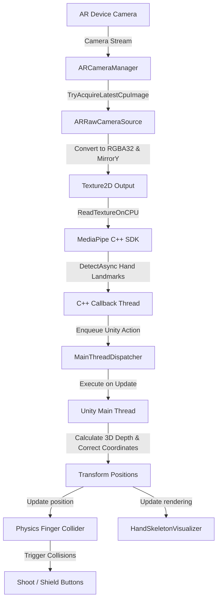

# Unity-MediaPipe-AR-Game Technical Report
## Real-Time Hand Tracking & Physical Gesture Interactions in Augmented Reality

This document provides a comprehensive technical overview of the **Unity-MediaPipe-AR-Game** project. It details the system architecture, code organization, and the specific **bridge solution** designed to run Google MediaPipe Hand Landmarker synchronously alongside Unity AR Foundation's camera subsystem.

---

## 1. Architectural Overview

The application combines Google's MediaPipe Machine Learning pipeline with Unity’s AR Foundation (XR subsystem) to allow touch-free, physical hand gesture interactions in an augmented reality environment. 

### Data Flow Pipeline

The system is structured as a pipeline that converts raw device camera feeds into 3D physics-based events on the Unity main thread:



### Core Components & Source Code

The project is structured around several custom C# scripts located in [Assets/Scripts](file:///home/newtonhaven/Desktop/arGame/Assets/Scripts) and [Assets/MediaPipeUnity](file:///home/newtonhaven/Desktop/arGame/Assets/MediaPipeUnity):

*   **[ARRawCameraSource.cs](file:///home/newtonhaven/Desktop/arGame/Assets/Scripts/ARRawCameraSource.cs)**: Bridges the AR camera subsystem to MediaPipe by capturing and formatting raw CPU camera frames.
*   **[HandLandmarkerRunner.cs](file:///home/newtonhaven/Desktop/arGame/Assets/MediaPipeUnity/Samples/Scenes/Hand%20Landmark%20Detection/HandLandmarkerRunner.cs)**: Orchestrates the MediaPipe Vision Task, feeds it textures, receives landmarks asynchronously, and estimates 3D hand positions.
*   **[MainThreadDispatcher.cs](file:///home/newtonhaven/Desktop/arGame/Assets/Scripts/MainThreadDispatcher.cs)**: A thread-safe utility queue that marshals background execution callbacks back to Unity's main thread.
*   **[HandSkeletonVisualizer.cs](file:///home/newtonhaven/Desktop/arGame/Assets/Scripts/HandSkeletonVisualizer.cs)**: Reconstructs and displays the physical skeleton of the player's hand in 3D world space.
*   **[ShootButton.cs](file:///home/newtonhaven/Desktop/arGame/Assets/Scripts/ShootButton.cs) & [ShieldButton.cs](file:///home/newtonhaven/Desktop/arGame/Assets/Scripts/ShieldButton.cs)**: Physics-enabled 3D buttons in AR space triggered by the virtual index finger tip.
*   **[GolemTarget.cs](file:///home/newtonhaven/Desktop/arGame/Assets/Scripts/GolemTarget.cs)**: An AR-anchored enemy entity that reacts to projectiles (rockets), manages respawns, and reports scores.

---

## 2. The Core Challenge: Bridging MediaPipe and AR

Out-of-the-box, Google MediaPipe and Unity's AR Foundation are incompatible due to three key obstacles:

1.  **Camera Ownership Conflict**: MediaPipe Unity samples default to reading from a `WebCamTexture`. However, in mobile AR (Android/iOS), the physical device camera is exclusively locked and driven by the AR engine (ARCore/ARKit) via Unity's `ARCameraManager`. Re-initializing the camera through a standard Unity `WebCamTexture` fails because the hardware resource is busy, or it breaks AR tracking entirely.
2.  **Threading Violations**: MediaPipe processes frames and dispatches inference results on a background C++ worker thread. Unity’s API is single-threaded; any attempts to instantiate GameObjects, modify positions (`Transform.position`), or check physics from a background callback cause an immediate crash or thread exception.
3.  **Dimension and Space Mismatch**: MediaPipe tracks landmarks in normalized, 2D viewport coordinates $(x, y \in [0, 1])$, relative to the image frame, with the origin $(0, 0)$ at the top-left. AR environments operate in a true 3D spatial coordinate system metric in meters, with varying aspect ratios, screen resolutions, and orientations.

---

## 3. The Bridge Solution

To overcome these challenges, the project implements a custom bridge architecture comprised of three main pillars: **Camera Frame Redirection**, **Thread Synchronization**, and **Perspective-based Depth Reconstruction**.

### 1. Camera Frame Redirection (`ARRawCameraSource`)
Instead of accessing the camera directly, `ARRawCameraSource` acts as a passive tap into the AR Foundation pipeline:
*   It subscribes to the `ARCameraManager.frameReceived` event.
*   Upon receiving a frame, it uses `TryAcquireLatestCpuImage` to obtain the raw image bytes in the GPU-friendly layout.
*   It applies a conversion structure to output a `TextureFormat.RGBA32` buffer, applying a `MirrorY` transformation to match the orientation.
*   The raw bytes are loaded onto a dynamic Unity `Texture2D` instance using `LoadRawTextureData()`.

```csharp
private unsafe void OnCameraFrameReceived(ARCameraFrameEventArgs eventArgs)
{
    if (!arCameraManager.TryAcquireLatestCpuImage(out XRCpuImage image)) return;

    var conversionParams = new XRCpuImage.ConversionParams
    {
        inputRect = new RectInt(0, 0, image.width, image.height),
        outputDimensions = new Vector2Int(image.width, image.height),
        outputFormat = TextureFormat.RGBA32,
        transformation = XRCpuImage.Transformation.MirrorY
    };

    if (_outputTexture == null || _outputTexture.width != image.width || _outputTexture.height != image.height)
    {
        _outputTexture = new Texture2D(image.width, image.height, TextureFormat.RGBA32, false);
    }

    int size = image.GetConvertedDataSize(conversionParams);
    var buffer = new NativeArray<byte>(size, Allocator.Temp);
    image.Convert(conversionParams, new IntPtr(buffer.GetUnsafePtr()), buffer.Length);
    _outputTexture.LoadRawTextureData(buffer);
    _outputTexture.Apply();

    image.Dispose();
    buffer.Dispose();
}
```

In the Editor environment (`UNITY_EDITOR`), the script automatically falls back to a standard `WebCamTexture` to ensure seamless debugging without deploying to physical devices.

### 2. Multi-threaded Synchronization (`MainThreadDispatcher`)
To prevent thread access violations when MediaPipe returns its landmarks:
*   A queue-based `MainThreadDispatcher` singleton is instantiated on the Unity main thread at startup.
*   When MediaPipe’s `OnHandLandmarkDetectionOutput` callback is triggered from the background thread, the data is unpacked, and the actual Unity operations (moving the virtual finger, spawning elements, UI updates) are wrapped into actions and enqueued.
*   `MainThreadDispatcher`'s `Update()` loop (running on the main thread) dequeues and executes these actions sequentially.

```csharp
MainThreadDispatcher.Instance().Enqueue(() => 
{
    float lx = 1f - indexTip.x;
    float ly = 1f - indexTip.y;
    Vector3 worldPos = mainARCamera.ViewportToWorldPoint(new Vector3(lx, ly, estimatedDepth));
    physicsFinger.position = worldPos;
});
```

### 3. Dynamic Depth Estimation (2D to 3D Viewport Mapping)
Since MediaPipe does not provide absolute metric depth relative to the lens in its live stream landmarks, the distance is calculated dynamically using **scale-based depth estimation**.

#### The Math:
Under a standard pinhole camera model, the projected size $s$ of a physical object on the image plane is inversely proportional to its distance $z$ from the lens:
$$s = f \cdot \frac{S}{z} \implies z = \frac{f \cdot S}{s}$$
Where $f$ is the focal length of the camera and $S$ is the physical size of the object. Since the human hand size and device camera parameters are relatively constant, we can combine $f \cdot S$ into a single tuning variable: `depthMultiplier`.

#### Implementation:
*   We select two landmarks that maintain a rigid distance on the hand: the **Wrist (Landmark 0)** and the **Middle Finger MCP (Landmark 9)**.
*   We calculate their 2D Euclidean distance in the normalized viewport space: `apparentSize`.
*   We calculate the estimated depth: $z = \frac{\text{depthMultiplier}}{\text{apparentSize}}$.
*   The depth is clamped between `minDepth` and `maxDepth` to prevent tracking outliers.

```csharp
float apparentSize = Vector2.Distance(new Vector2(wrist.x, wrist.y), new Vector2(middleMcp.x, middleMcp.y));
if (apparentSize < 0.001f) apparentSize = 0.001f;

float estimatedDepth = depthMultiplier / apparentSize;
estimatedDepth = Mathf.Clamp(estimatedDepth, minDepth, maxDepth);
```

### 4. Coordinate Transformation & Mirroring
To align the normalized landmark positions with the viewport space:
*   **Vertical Correction**: MediaPipe's coordinates start at $(0,0)$ on the top-left, while Unity's viewport starts at $(0,0)$ on the bottom-left. This is corrected by setting $y_{\text{unity}} = 1.0 - y_{\text{mediapipe}}$.
*   **Horizontal Mirror Correction**: To provide a natural front-facing or passthrough interaction (similar to looking in a mirror), the horizontal coordinate is inverted: $x_{\text{unity}} = 1.0 - x_{\text{mediapipe}}$.
*   These corrected values are combined with the calculated depth into a `Vector3` and fed to `Camera.ViewportToWorldPoint()`.

---

## 4. Gameplay Mechanics & Interaction Design

The game maps the player's physical movements into the virtual environment using several interactable components:

### The Physics Finger
In [HandLandmarkerRunner.cs](file:///home/newtonhaven/Desktop/arGame/Assets/MediaPipeUnity/Samples/Scenes/Hand%20Landmark%20Detection/HandLandmarkerRunner.cs), a virtual 3D GameObject called `physicsFinger` (holding a Rigidbody and Sphere Collider) is continuously mapped to the position of the player's **Index Finger Tip (Landmark 8)**.

### In-World Physical Buttons
Two 3D button prefabs, **Shoot** and **Shield**, are placed in the AR space:
*   They contain a `BoxCollider` set as a trigger and require a `Button` UI component.
*   When the physical finger collider enters the button boundaries, `OnTriggerEnter` is triggered, raising the UI `onClick` event and playing sound/visual feedback.
*   A cooldown timer prevents double-triggering during a single hand press.

### The Golem Target
The enemy is represented by the `GolemTarget` script:
*   **AR Stabilization**: To ensure the Golem remains firmly anchored in the physical room and doesn't drift, it automatically adds an `ARAnchor` component at startup.
*   **Combat Interactions**: It monitors collisions. When struck by a `RocketProjectile` (spawned by the Shoot button), it calls `Die()`, reports the event to the `GameScoreManager` to add points, plays a death sound, spawns a particle effect, and disables its renderers.
*   **Respawn Loop**: Upon death, the Golem's old `ARAnchor` is destroyed, its position is randomized within a bounding area (`respawnAreaMin` to `respawnAreaMax`), a new `ARAnchor` is added to lock it in place, and it reappears after a short delay.

---

## 5. Technical Stack Details

*   **Engine**: Unity 2022.3.x (XR/AR Foundation)
*   **Hand Tracking Framework**: Google MediaPipe (Vision Tasks API)
*   **Tracking Model**: [hand_landmarker.bytes](file:///home/newtonhaven/Desktop/arGame/Assets/StreamingAssets/hand_landmarker.bytes) (stored in StreamingAssets)
*   **Rendering Pipeline**: Universal Render Pipeline (URP) / Built-in Pipeline
*   **Threading Strategy**: Native thread execution synchronized with a C# thread-safe main loop queue.
